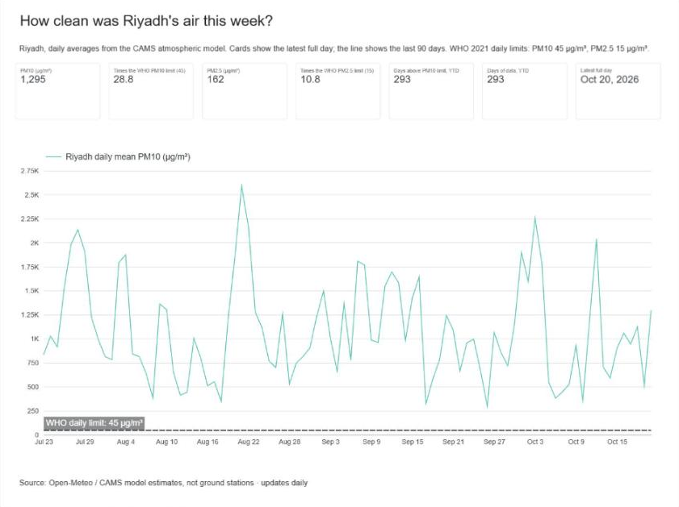
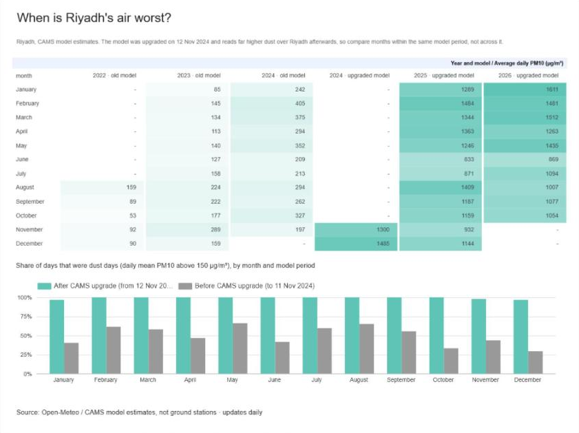
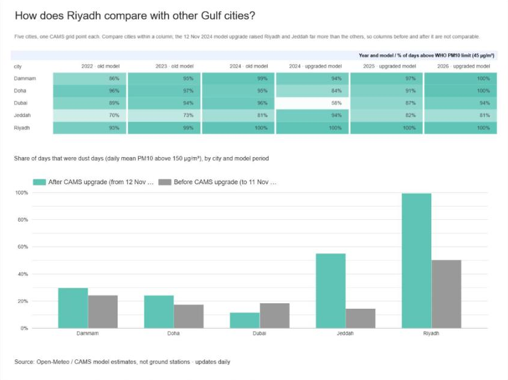

# Riyadh Air Quality & Dust Tracker

**How dusty is Riyadh's air, how often does it break the WHO daily guideline, and how does it compare with other Gulf cities?**

This project answers that every day, with no manual work. A Python script on GitHub Actions pulls hourly particulate estimates for Riyadh, Jeddah, Dammam, Dubai and Doha. It turns them into daily figures, checks them and commits them to this repo. A Looker Studio dashboard reads the files through a Google Sheet.

**Live dashboard:** [Riyadh Air Quality & Dust Tracker (Looker Studio)](https://datastudio.google.com/reporting/ae53592e-9b5c-4750-8d65-7ada64b39ccc)



| When is Riyadh's air worst? | How does Riyadh compare with other Gulf cities? |
|---|---|
|  |  |

Data runs from **5 Aug 2022** and updates every day at 03:00 Riyadh time. Each update adds the previous full day.

## Findings

These are model estimates (see Limitations). The model was upgraded on 12 Nov 2024, so every comparison below is made **within one model period**, never across the break.

**1. Riyadh has the dustiest air of the five cities in both model periods.** Before the upgrade, Riyadh's median daily PM10 was 150 µg/m³, against 62–99 for the other four cities. After it, the median was 1,155 against 83–222. Riyadh's median day is above the WHO "interim target 1" level of 150, which this project uses as its dust-day line. Half of Riyadh's days were dust days before the upgrade, against 14–24% in the other cities.

**2. Fine particles (PM2.5) are above the WHO daily guideline almost every day, everywhere.** In all five cities and both periods, the daily PM2.5 mean was above 15 µg/m³ on 89–100% of days. This is the most robust result in the project, because it holds in every city under both model versions.

**3. The November 2024 model upgrade changed the numbers more than the weather did.** Riyadh's median PM10 jumped from 150 to 1,155 µg/m³, and Jeddah's from 62 to 222, with most of the change in December–May. Dubai's median stayed at 83. A sevenfold change that appears overnight in two cities but not in a third points to a change in the model, not in the air. That is why the dashboard marks the break and the project makes no trend claims across it. Reading the data well includes recognising when a change comes from the measurement rather than the world.

## Data

[Open-Meteo Air Quality API](https://open-meteo.com/en/docs/air-quality-api), which serves the European **CAMS** global atmospheric model on a grid of roughly 45 km. Each city is one grid point:

| City | Lat, Lon |
|---|---|
| Riyadh | 24.71, 46.68 |
| Jeddah | 21.49, 39.19 |
| Dammam | 26.43, 50.10 |
| Dubai | 25.20, 55.27 |
| Doha | 25.29, 51.53 |

Hourly variables used: `pm10`, `pm2_5` and `dust`, all in µg/m³. The API's history starts in August 2022; the first complete day is 5 Aug 2022.

## Method

```
Open-Meteo API ──► src/air_quality.py (GitHub Actions, daily) ──► data/daily.csv, data/summary.csv
                                                                     │
                       Looker Studio dashboard ◄── Google Sheet (IMPORTDATA)
```

1. **Fetch.** Each run asks for hourly data in Riyadh local time (UTC+3). It re-fetches the last 7 days, because the model sometimes revises recent values; a newer value replaces the stored one. A manual "backfill" option rebuilds the full history.
2. **Aggregate.** For each city and Riyadh-local day, the script computes mean and max PM10, mean PM2.5 and max dust. It keeps a day only when all 24 hours are present. Today is never included because it is not over yet; the API also returns forecast hours for it.
3. **Flag.** Each day gets 1/0 flags:
   - `above_who_pm10`: PM10 mean above 45 µg/m³ (WHO 2021 daily guideline)
   - `above_who_pm25`: PM2.5 mean above 15 µg/m³ (WHO 2021 daily guideline)
   - `dust_day`: PM10 mean above 150 µg/m³ (WHO interim target 1)

   Averaging a 1/0 flag gives the share of days, which is how the dashboard shows "% of days above the limit".
4. **Check.** The run fails, and GitHub emails me, if:
   - any city-day is missing between 5 Aug 2022 and the newest day
   - any value is negative or not a number
   - any row is duplicated
   - the newest day is more than 3 days old

   A daily PM2.5 mean above PM10 only logs a warning, because PM2.5 is part of PM10 and this would hint at a data problem rather than prove one.
5. **Publish.** The two CSVs are committed only when they changed. If the repository ever goes 45 days without a commit, the workflow re-enables itself, so GitHub does not pause the schedule after 60 days of inactivity.
6. **Test.** 15 `pytest` tests run before every update, using real API responses saved in `tests/fixtures/`. One test recomputes a day's mean by hand from the 24 hourly values.

## Limitations

- **Model estimates, not measurements.** CAMS is a global model. Each value covers a grid cell about 45 km wide, not a monitoring station, and it can differ greatly from what a ground sensor in the city would read.
- **The CAMS upgrade on 12 Nov 2024 breaks the series.** Values for Riyadh and Jeddah are several times higher afterwards. Every row has a `model_period` column, the dashboard marks the break, and no claim compares the two periods.
- **Very high PM10 is a lower bound.** The API cannot return PM10 above about 3,277 µg/m³; it returns a blank instead. When an hour is blank during extreme dust (dust ≥ 3,000), the script uses 3,277 and counts the hour in `pm10_capped_hours`. This has happened for 103 hours across 28 city-days. On those days the real mean was at least as high as shown.
- **Four days of model outage.** From 13 to 16 Dec 2022, every city reads almost zero PM10 and zero dust. These days are kept but marked `suspect = 1`, their flags are left blank, and they are excluded from the counts.
- **Daily guideline, not a health assessment.** The WHO values are guidelines for 24-hour averages. Being above them does not measure how many people were exposed or for how long.
- **"Dust day" is my definition.** It means a daily PM10 mean above 150 µg/m³. It is a threshold, not an official dust-storm classification.
- **The dashboard can lag by about an hour.** The Google Sheet re-reads the CSVs about every hour, so for a short time after the 03:00 update the dashboard may still show the previous day.

## Files

```
src/air_quality.py           Fetch, aggregate, check and write the CSVs
tests/                       pytest tests and saved API responses
.github/workflows/update.yml Daily schedule (00:00 UTC) and manual run with backfill
data/daily.csv               One row per city per day
data/summary.csv             One row: Riyadh's latest day and year-to-date counts
```

### `data/daily.csv` columns

| Column | Meaning |
|---|---|
| `date`, `city`, `year`, `month` | Riyadh-local day and city |
| `pm10_mean`, `pm10_max` | Daily mean and highest hourly PM10, µg/m³ |
| `pm25_mean` | Daily mean PM2.5, µg/m³ |
| `dust_max` | Highest hourly dust, µg/m³ |
| `above_who_pm10`, `above_who_pm25`, `dust_day` | 1/0 flags (blank on suspect days) |
| `pm10_capped_hours` | Hours set to the API cap (lower bound) |
| `suspect` | 1 on the December 2022 model-outage days |
| `model_period` | Before or after the 12 Nov 2024 CAMS upgrade |

## Run it yourself

```
pip install -r requirements.txt
pytest -q
python src/air_quality.py              # update to yesterday
python src/air_quality.py --backfill   # rebuild from 5 Aug 2022
```

Tools: Python (requests, pytest), GitHub Actions, Google Sheets, Looker Studio.
